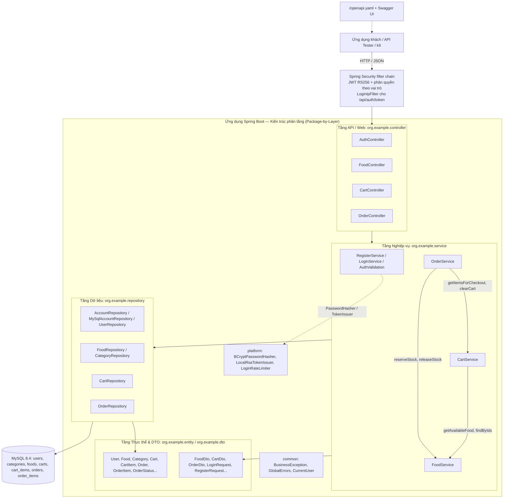
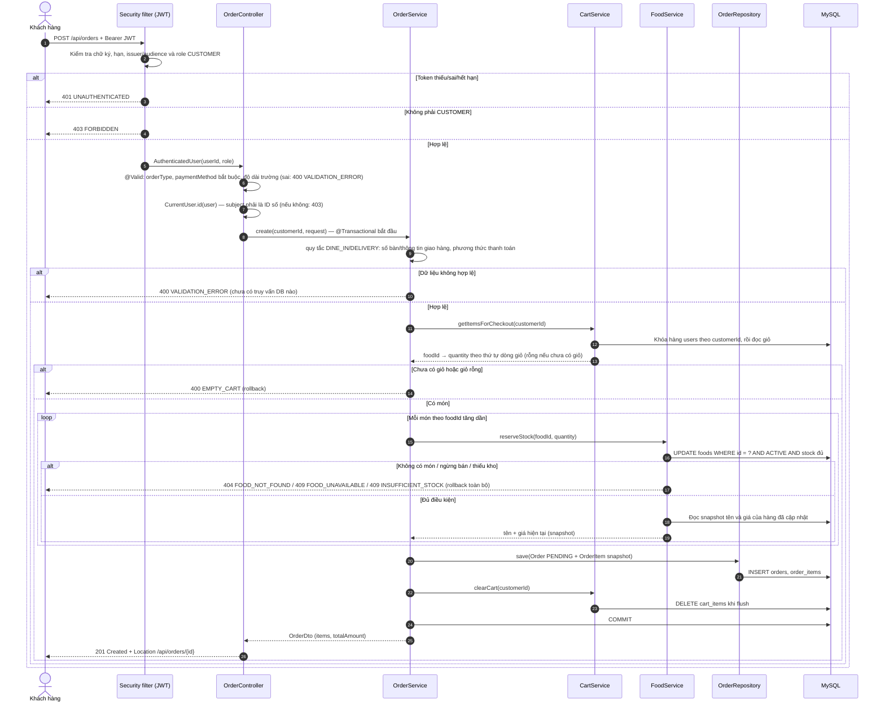
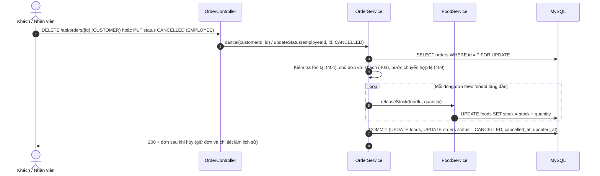
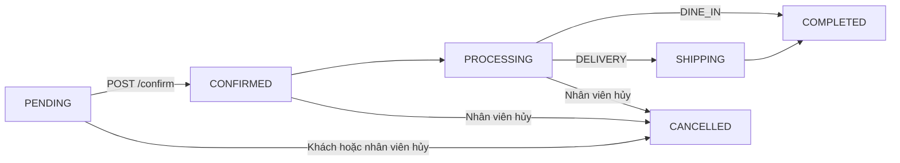

# ByteMe

## Phân tầng theo nhiệm vụ (Package-by-Layer)

Mã nguồn được tổ chức theo nhiệm vụ của từng tầng kỹ thuật; các quy tắc phân tầng được `src/test/java/org/example/ArchitectureTest.java` (ArchUnit) kiểm tra tự động.
| Tầng | Package | Trách nhiệm | Được phép phụ thuộc |
| --- | --- | --- | --- |
| Bảo mật | `config.SecurityConfiguration`, `platform.security` | Xác thực JWT, phân quyền endpoint theo vai trò, giới hạn đăng nhập | Spring Security |
| API / Web | `controller`, `dto` | Tiếp nhận và điều hướng HTTP/JSON request, `@Valid` kiểm tra dữ liệu đầu vào, bóc tách `CurrentUser` | Service, DTO, entity enum, `shared.api`, Spring Web |
| Nghiệp vụ | `service` | Quy tắc nghiệp vụ, ranh giới transaction (`@Transactional`), ném lỗi nghiệp vụ (`BusinessException` ở Food/Cart/Order; `AuthFailure`, `DuplicateAccountException`, `AccountPersistenceException` ở Auth) | Repository, Entity, DTO, các Service khác. **Không** import Spring Web/HTTP, Servlet, Spring Data, JDBC, JPA, Hibernate |
| Truy cập dữ liệu | `repository`, `entity` | Spring Data JPA (CRUD, custom query, `CartRepository.saveChanges`), ánh xạ thực thể CSDL | JPA/Hibernate, MySQL |
| Dùng chung | `common`, `shared.api` | `BusinessException`, `CurrentUser`, `ApiError`, `GlobalErrors`; `AuthenticatedUser`, `Role` | — |

Lỗi nghiệp vụ: service của Food/Cart/Order ném `BusinessException(type, code, message)`; `GlobalErrors` đổi `INVALID/FORBIDDEN/NOT_FOUND/CONFLICT` thành 400/403/404/409 với body `{status, code, message, path, fieldErrors}`. Auth giữ handler riêng `AuthErrors` cho `AuthFailure` và `DuplicateAccountException`.

## Sơ đồ kiến trúc

Mũi tên giữa các service là lời gọi Java trực tiếp. Các method được gọi đều là `@Transactional` với propagation mặc định (`REQUIRED`), nên khi `OrderService` gọi `CartService`/`FoodService` thì tất cả tham gia **cùng một transaction**: commit cùng nhau hoặc rollback cùng nhau.

Quy tắc ranh giới phân tầng:

- `CartItem` chỉ lưu `foodId`; Cart lấy thông tin món để hiển thị qua `FoodService.findByIds` và kiểm tra món còn bán qua `FoodService.getAvailableFood`.
- `OrderItem` chỉ lưu `foodId` cùng snapshot `foodName`/`unitPrice`; Order không phụ thuộc entity `Food`.
- Controller chỉ gọi qua Service; không bao giờ gọi trực tiếp Repository. Service không phụ thuộc Controller.

## Sequence UC13 — Tạo đơn hàng

Giá và tổng tiền do server tính từ dữ liệu món đọc trong transaction; client không gửi danh sách món, giá hay `userId`. Tổng tiền không lưu trên `orders` mà tính từ `order_items` (`OrderDto.totalAmount` = tổng `unitPrice × quantity`). Mọi lỗi trong transaction, kể cả lỗi hệ thống (500), đều rollback trước khi trả về.

Giỏ được tạo ở lần thêm món đầu tiên (`addToCart`). `GET /api/cart` khi chưa có giỏ trả `200` với `id: null`, `items: []` và không ghi gì vào database. Sửa/xóa dòng giỏ khi chưa có giỏ trả `404 CART_ITEM_NOT_FOUND`.

Checkout và các thao tác ghi giỏ dùng chung khóa hàng `users`, kể cả lần đầu tạo giỏ. Admin lấy khóa ghi hàng `foods` trước khi đọc để sửa hoặc ngừng bán món. Khi admin truyền `stockQuantity`, giá trị đó là mức tồn kho tuyệt đối tại thời điểm cập nhật. MySQL có thể vẫn báo tranh chấp khóa và ứng dụng trả `409 CONCURRENT_UPDATE`. Xem [khảo sát trước cải tiến](phase2/checkout-before.md) để đối chiếu hành vi Pha 1.

## Sequence hủy đơn (UC15, UC17)

`cancel`, `confirm` và `updateStatus` dùng chung khóa hàng Order. Sau khi kiểm quyền, yêu cầu hủy đơn đã `CANCELLED` trả `200` với đơn đã lưu và giữ nguyên kho lẫn timestamp. Hoàn kho áp dụng cả cho món đã ngừng bán.

## Trạng thái theo hình thức phục vụ

| Trạng thái hiện tại | Nhân viên được chuyển sang | Khách được chuyển sang |
| --- | --- | --- |
| PENDING | CONFIRMED, CANCELLED | CANCELLED |
| CONFIRMED | PROCESSING, CANCELLED | — |
| PROCESSING | CANCELLED; DINE_IN → COMPLETED; DELIVERY → SHIPPING | — |
| SHIPPING | COMPLETED | — |
| COMPLETED, CANCELLED | — | — |

Xác nhận lưu `confirmed_by`/`confirmed_at`; hủy lưu `cancelled_at`, giữ thông tin xác nhận nếu có; hoàn thành lưu `completed_at`. Thời gian do `OrderService` gán theo UTC (độ chính xác micro giây); thứ tự các mốc do service bảo đảm, schema không có CHECK. CASH chỉ cho DINE_IN, COD chỉ cho DELIVERY, BANK_TRANSFER cho cả hai. `tableNumber` là nhãn bàn lưu trong đơn; giai đoạn này chưa có đặt bàn hay quản lý bàn.
