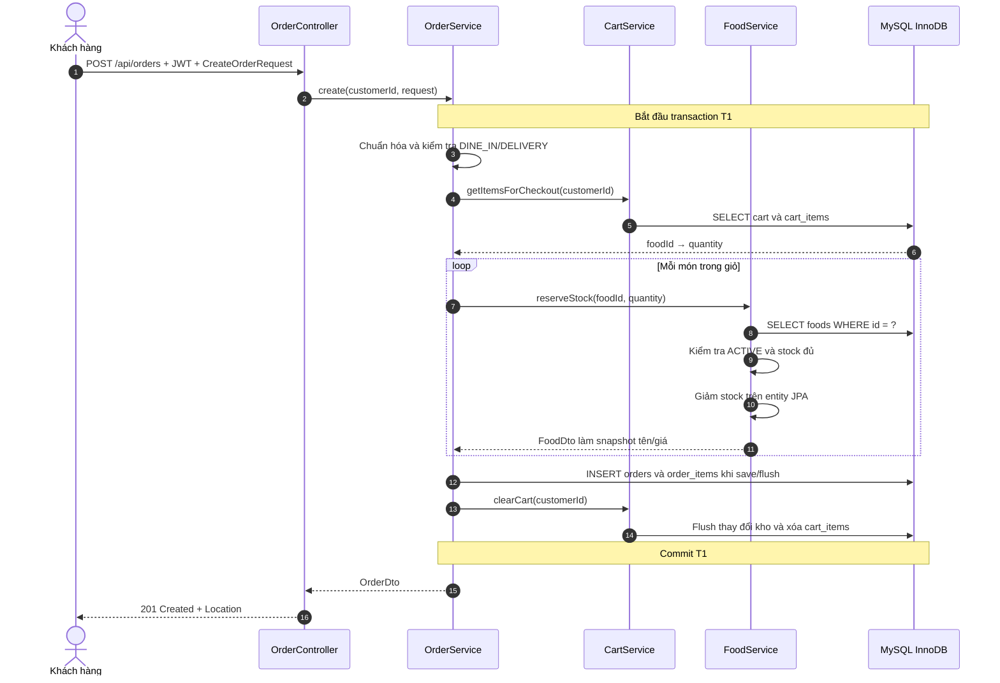

# Khảo sát checkout và baseline trước cải tiến

## Mục đích và trạng thái

Tài liệu này ghi nhận luồng checkout và hủy đơn ở Pha 1 tại commit `510f6415b6af535ceec77213f0b0c7d5082123f7` (nhánh `tien_manh`), cùng các ca cần chạy để lưu baseline correctness trước khi sửa code.

**Trạng thái baseline đồng thời: chưa chạy.** Đây là trạng thái đo, không phải kết quả pass. Chưa có log từ lượt chạy checkout cạnh tranh trên commit này, vì vậy không kết luận đã tái hiện hoặc loại trừ oversell, tạo đơn trùng hay hoàn kho hai lần. Các nhận xét về khả năng lỗi dưới đây suy ra từ luồng code và cần được xác minh bằng test MySQL.

## Mốc code và bằng chứng đã kiểm tra

| Thành phần | Vị trí | Hành vi hiện tại |
| --- | --- | --- |
| Tạo đơn HTTP | `src/main/java/org/example/controller/OrderController.java` | `POST /api/orders`, lấy customer ID từ JWT, gọi service, trả `201` và `Location`. Chưa nhận idempotency key. |
| Checkout | `src/main/java/org/example/service/OrderService.java` — `create` | `@Transactional`; kiểm tra loại đơn, đọc giỏ, dự trữ từng món, lưu Order/OrderItem, xóa giỏ. |
| Đọc và xóa giỏ | `src/main/java/org/example/service/CartService.java` | `getItemsForCheckout` trả map `foodId → quantity`; `clearCart` xóa dòng nhưng giữ Cart. Chưa có khóa chung với checkout hoặc thao tác sửa giỏ. |
| Trừ và hoàn kho | `src/main/java/org/example/service/FoodService.java` — `reserveStock`, `releaseStock` | Đọc Food bằng `findById`, kiểm tra rồi giảm hoặc tăng `stockQuantity` trên entity đã đọc. Chưa cập nhật nguyên tử có điều kiện. |
| Hủy và chuyển trạng thái | `OrderService.cancel`, `updateStatus`, `moveTo` | Đọc Order thông thường; kiểm tra trạng thái trong Java; khi chuyển CANCELLED thì hoàn kho từng dòng rồi gán trạng thái. Chưa khóa Order. |
| Admin sửa món | `FoodService.updateFood`, `deleteFood` | Đọc entity rồi thay đổi các trường, bao gồm tồn kho và trạng thái; chưa khóa đồng bộ với checkout. |
| Schema | `src/main/resources/db/schema.sql` | Chưa có bảng idempotency. Ứng dụng cấu hình `ddl-auto: none`; `CREATE TABLE IF NOT EXISTS` không nâng cấp DB đã tồn tại. |
| Test MySQL | `src/test/java/org/example/OrderIntegrationTest.java` | Dùng Testcontainers MySQL 8.4; có kiểm tra snapshot, rollback khi clear giỏ lỗi, món sau thiếu kho, hủy và khôi phục kho. Chưa có test request checkout đồng thời. |

Transaction của `OrderService.create` bao trùm các lời gọi `CartService` và `FoodService` vì các service đó dùng propagation mặc định `REQUIRED`. Vì vậy lỗi unchecked trước commit được kỳ vọng rollback cùng kho, Order/OrderItem và giỏ. Test tích hợp hiện có đã kiểm tra một số đường rollback; điều đó không tự giải quyết race condition giữa hai transaction độc lập.

## Luồng checkout hiện tại

Giá, tên món và user ID do server lấy; client không gửi danh sách món hoặc giá. `totalAmount` được tính từ snapshot `OrderItem`. Giỏ chưa tồn tại hoặc rỗng trả `400 EMPTY_CART`. Món không tồn tại trả `404 FOOD_NOT_FOUND`; món ngừng bán và thiếu kho trả `409 FOOD_UNAVAILABLE` hoặc `409 INSUFFICIENT_STOCK`. Deadlock/lock timeout đã được ánh xạ thành `409 CONCURRENT_UPDATE`; server hiện không tự retry.

## Luồng hủy hiện tại

Khách gọi `DELETE /api/orders/{orderId}` và chỉ được hủy đơn của mình ở `PENDING`. Nhân viên gọi `PUT /api/orders/{orderId}/status` với `CANCELLED`; các trạng thái `PENDING`, `CONFIRMED`, `PROCESSING` có thể bị nhân viên hủy. `SHIPPING` và `COMPLETED` không thể hủy. Hủy tuần tự lần hai hiện trả `409 INVALID_ORDER_TRANSITION`.

Trong transaction, service đọc Order, kiểm tra quyền/trạng thái, gọi `releaseStock` cho từng OrderItem, rồi đổi trạng thái và timestamp. Lỗi unchecked trước commit rollback thay đổi cùng transaction. Tuy nhiên hai request đồng thời có thể cùng đọc trạng thái chưa hủy và cùng hoàn kho trước khi ghi `CANCELLED`.

## Rủi ro cần kiểm chứng

1. **Hai khách tranh món cuối:** hai transaction có thể cùng đọc stock đủ rồi cùng ghi giá trị stock mới dựa trên lần đọc cũ (lost update). Kết quả đơn được chấp nhận có thể vượt lượng hàng ban đầu dù stock cuối không âm.
2. **Hai checkout cùng giỏ:** không có khóa trên user/cart. Request thứ hai có thể tiếp tục dùng nội dung giỏ đọc trước khi request đầu xóa giỏ, hoặc gặp tranh chấp/rollback.
3. **Sửa giỏ trong checkout:** `addToCart`, `updateCartItem`, `removeCartItem` không lấy khóa chung với checkout; một thay đổi vừa được commit có thể bị `clearCart` xóa mà không vào Order.
4. **Hủy đồng thời hoặc hủy đua cập nhật trạng thái:** nhiều request có thể cùng dựa trên trạng thái cũ; cần kiểm tra hoàn kho tối đa một lần và transition cuối hợp lệ.
5. **Admin sửa món cạnh tranh:** `updateFood` có thể ghi lại `stockQuantity` từ entity cũ sau khi checkout thay đổi stock.
6. **Retry sau khi server commit:** client không có key để nhận diện ý định cũ. Nếu server commit nhưng client mất response, retry có thể nhận `EMPTY_CART`; nếu giỏ được tạo lại, có thể tạo đơn mới.
7. **Thứ tự ghi và khóa:** hiện code giảm stock trên entity nhưng SQL có thể flush sau thao tác lưu OrderItem. Rủi ro deadlock phải được xác minh từ log MySQL; sắp xếp ID một mình chưa đủ nếu trình tự SQL khác.

## Baseline correctness cần chạy trên commit này

Ưu tiên dùng MySQL 8.4 như test hiện tại, mỗi worker đi qua request/transaction riêng. Không dùng một transaction bao toàn bộ test làm các request dùng chung snapshot. Commit dữ liệu setup trước khi phát barrier; sau khi worker kết thúc, đọc DB bằng transaction mới. Chạy mỗi ca nhiều lần và lưu cả lượt không tái hiện được race.

| Mã | Thiết lập | Bằng chứng cần lưu |
| --- | --- | --- |
| B01 | Hai khách và hai giỏ độc lập, cùng tranh một món có stock 1; nhiều lần đồng bộ bắt đầu | HTTP status/body; số lượng đơn và OrderItem đã commit; tổng lượng bán; stock đầu/cuối; exceptions/deadlock. Oversell = max(0, lượng bán đã commit − stock đầu). |
| B02 | Hai request checkout của cùng một khách/giỏ được phát đồng thời | Số đơn tạo; trạng thái giỏ; stock; response mỗi request. |
| B03 | Hai request hủy cùng một đơn đang PENDING | Stock trước/sau; `status`, `cancelled_at`; số lần hoàn theo OrderItem. |
| B04 | Checkout giỏ nhiều món, đặt stock món sau không đủ | Số Order/OrderItem; stock mọi món; giỏ còn nguyên hay không. |
| B05 | Tiêm lỗi sau khi gọi `clearCart` nhưng trước commit | Số Order/OrderItem, stock và cart_items sau rollback. Test gần tương ứng đã tồn tại trong `OrderIntegrationTest`; lưu kết quả chạy theo commit. |

### Kết quả chạy

| Trường | Giá trị cần điền sau lượt thực tế |
| --- | --- |
| Commit/JAR SHA-256/schema/seed | Chưa ghi nhận |
| MySQL image và isolation | MySQL 8.4 qua Testcontainers; isolation cấu hình thực tế chưa ghi nhận |
| Máy và cấu hình chạy | Chưa ghi nhận |
| Số lượt từng ca | Chưa chạy |
| B01 oversell / deadlock / 5xx | Chưa đo |
| B02 số đơn và kết quả | Chưa đo |
| B03 số lần hoàn kho sai | Chưa đo |
| B04/B05 rollback | Có test cùng mục tiêu trong `OrderIntegrationTest`, nhưng kết quả chạy trên commit này chưa ghi nhận |
| Log gốc và người chạy | Chưa ghi nhận |

Không điền số liệu dự kiến vào bảng này. Sau khi chạy, lưu raw log cùng commit và môi trường. Nếu baseline không tái hiện race, ghi số lượt và điều kiện; kết luận khi đó là “chưa tái hiện trong N lượt”, không phải “đã chứng minh không thể xảy ra”.

## Quy trình chạy khi nhóm sẵn sàng

1. Chốt và checkout SHA BEFORE đã được nhóm duyệt; xác nhận `git status --short` sạch.
2. Chạy `./mvnw test` hoặc `./mvnw.cmd test` trên Windows với Docker daemon hoạt động; test dùng MySQL Testcontainers.
3. Bổ sung/chạy fixture cạnh tranh ở test tích hợp hoặc harness HTTP có transaction riêng. Đồng bộ worker bằng `CountDownLatch`/barrier và lưu timeout; tránh dùng `sleep` làm bằng chứng đồng bộ.
4. Chạy B01–B03 lặp lại trên đúng seed đã ghi; B04–B05 có thể dùng test tích hợp đã có sau khi xác nhận kết quả.
5. Lưu log vào `kaggle/results/phase2-checkout/before/` hoặc đường dẫn artifact nhóm thống nhất; không ghi secret/token.

## Giới hạn phạm vi

Tài liệu này ghi nhận code và quy trình; không chứa kết quả concurrency chạy thực tế. Tải phase 1 trong `kaggle/results/phase1-baseline/README.md` là workload hỗn hợp đọc thực đơn/giỏ/đăng nhập, không phải baseline latency/throughput riêng cho checkout.
